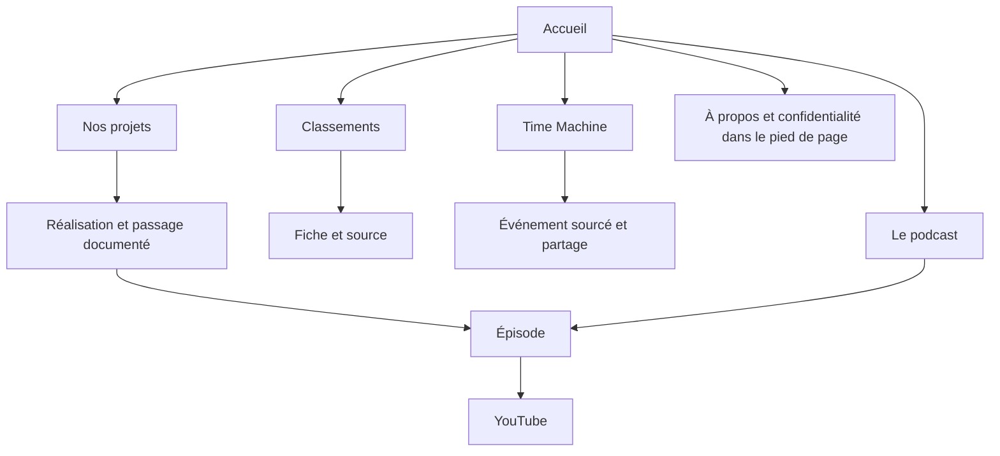

# Stratégie UX SANDBOX

15 octobre 2026. Décision de conception : décidée par l'agent sur délégation (PD-0003), à partir du brief et des corrections de Lou. [DD-0032](design-decisions/DD-0032-accueil-marque-et-plateau.md) remplace l'accueil de DD-0031. Le raisonnement business est dans [l'audit](SANDBOX_AUDIT.md).

## Positionnement et publics

SANDBOX est le podcast IA et tech de Lou, Loïc et Nico. La proposition de travail est "Comprendre l'IA. En la pratiquant." Elle relie leurs essais d'outils et les projets qu'ils construisent. L'accueil doit faire comprendre cette proposition avant de présenter l'étendue du contenu.

Le public de travail rassemble des curieux de l'IA intéressés par des usages concrets. Cette cible n'a pas encore été validée par des entretiens ou des données d'audience. Les pages annexes ont chacune leur propre utilité : veille pour les classements, compréhension historique pour la Time Machine, réalisations pour Nos projets. Une personne peut y trouver sa réponse sans regarder le podcast.

## Accueil

Le parcours suit [DD-0034](design-decisions/DD-0034-accueil-equipe-projets-puis-rubriques.md), selon la demande de Lou :

1. Le premier écran : "Le podcast IA & tech", "L'IA, en pratique.", puis "On teste des outils. On construit des projets. On en parle ensemble." et un bouton "Regarder le dernier épisode". Les trois animateurs sont assis sur un plateau télé provisoire, réalisé à partir de leurs portraits. [DD-0033](design-decisions/DD-0033-accueil-cinematique-et-trio-sur-plateau-tv.md) précise le cadrage, les proportions et le mouvement.
2. Les trois portraits, suivis de biographies rédigées à partir des projets documentés. Lou a choisi cette base. Les biographies publiées dans la collection Animateurs ont priorité quand elles sont renseignées.
3. Une sélection de trois réalisations, une par animateur : Not My Fault, Song Maker et Sillage. Chaque aperçu rejoint sa fiche ; un lien ouvre le catalogue complet.
4. Les accès à la Time Machine et aux classements, après la présentation de l'équipe et de ses projets.
5. Un seul dernier épisode réel, avec sa miniature, sa date, son titre et un lien YouTube. Sans épisode publié, cette partie disparaît et le bouton principal rejoint `/podcast` avec le libellé "Découvrir l'émission".

Le premier écran conserve seulement le logo, le choix de langue, le message et le plateau avec son action. Les onglets, la recherche et le menu mobile sont masqués sur l'accueil. Les rubriques se découvrent en descendant et restent accessibles dans le pied de page. Les autres pages conservent leur navigation complète. Les éditions des classements ne sont pas chargées par l'accueil. Les anciennes sélections dans son URL rejoignent `/charts` avec leurs paramètres.

Sur ordinateur, le message occupe l'espace au-dessus de la table du plateau. Sur mobile, le décor descend sous le texte et conserve les trois places. Le texte reste du HTML. L'image garde une place réservée pour éviter un déplacement de la mise en page. Le logo officiel n'est pas incorporé au visuel généré.

La scène définitive est en cours de conception par Lou. Une future vidéo ou un maillage 3D pourra remplacer l'image, après vérification des ressources et du coût de rendu. Cette version sert à juger le message, les proportions et le cadrage ; elle ne simule pas une vraie scène 3D navigable.

## Architecture et navigation

```text
Accueil /
  Classements /charts
    GitHub /charts/github
    Skills /charts/skills
    Modèles IA /charts/ai-models
    À suivre /charts/rising
    Fiches, archives, méthodes et Awards (URL existantes)
  Time Machine /time-machine
    Événement #ia-identifiant
    Année #wrapped-année
  Nos projets /nos-projets
    Fiche /nos-projets/slug
  Le podcast /podcast
    Épisode /episodes/numéro
  À propos /about (pied de page et podcast)
  Recherche /search (outil de navigation)
  Confidentialité /confidentialite (pied de page)
  Guides : modèle et gabarit préparés, aucune page publique vide
```



| URL                  | Parent  | Accès                       | Rôle                                 |
| -------------------- | ------- | --------------------------- | ------------------------------------ |
| `/charts`            | Accueil | Après les projets           | Explorer les classements             |
| `/time-machine`      | Accueil | Après les projets, français | Comprendre l'histoire de l'IA        |
| `/nos-projets`       | Accueil | Troisième section           | Essayer les réalisations de l'équipe |
| `/podcast`           | Accueil | Replay et pied de page      | Regarder l'émission                  |
| `/episodes/[number]` | Podcast | Replay et liens contextuels | Vidéo, chapitres et ressources       |
| `/about`             | Accueil | Pied de page et podcast     | Identifier les auteurs               |

Les versions locales réutilisent ces pages et les dictionnaires existants. La Time Machine n'a pas de fausse route traduite. Les URL anciennes et les redirections préparées sont conservées. Les liens vers les guides n'apparaissent qu'après une publication réelle, lors de leur activation.

## Classements et chronologie

Dans les classements, le nom et une phrase d'usage précèdent l'examen des métriques. Le rang officiel reste inchangé lorsqu'on filtre. Le choix de catégorie ou de capacité reste immédiatement accessible. Les horodatages détaillés et le profil sont dans une zone dépliable ; la date d'édition et le retard restent visibles. Les sources et preuves ne disparaissent pas. Aucun score n'est recalculé pour la refonte.

La Time Machine conserve son graphique, ses filtres, sa recherche, la navigation clavier, les bornes annuelles, la liste HTML complète et les exports. Les options avancées se replient pour rapprocher le premier événement de l'en-tête. Le cadran décoratif disparaît. Un lien copie l'événement sélectionné ou le récapitulatif de l'année. Une ancre absente ou invalide garde une sélection valide. La lecture reste volontaire et respecte la réduction des mouvements.

Nos projets garde les 34 fiches et son filtre. La page de catalogue présente les contenus une fois. La recherche générale retrouve les événements de la chronologie et ne renvoie plus des entités connues comme démonstrations.

## Podcast et guides

Le dernier épisode est présent une fois sur l'accueil et en tête de sa rubrique. Le podcast explique brièvement les quatre séquences : Radar, Build, Clash et Bêta. Les liens projet-épisode existants reposent sur des mentions, ressources et chapitres vérifiés. Aucun lien entre un événement historique et une émission n'est inféré par simple mot-clé.

Un guide est un sujet autonome, un résultat attendu, un clip YouTube publié, quelques étapes, des ressources et la référence d'un épisode réellement publié. Le modèle exige des liens HTTPS, un niveau, une audience et une date. Le catalogue initial est vide. Le gabarit réutilise le lecteur à la demande. Aucun CMS, dépendance, route publique vide, article inventé ou nouveau mécanisme de publication n'est nécessaire maintenant.

## Direction artistique

Logo officiel inchangé. Fond bleu nuit, texte clair et cyan pour l'action principale. L'accueil et le menu utilisent Archivo, sans mélange avec un titre en italique ou des capitales monospace. Le plateau constitue l'image forte. Les espacements, deux niveaux de gris et un filet séparent les contenus. Les contrôles restent tactiles, les titres longs se replient et les états de focus sont visibles. Le contenu utile doit rester accessible à 320 pixels.

Le dernier épisode garde son titre réel et sa miniature. Les données, les sources et les limites restent présentes dans leurs rubriques. Une courte avancée dans le décor accompagne le défilement natif sur ordinateur, avec une commande de réduction des mouvements. Le mobile et la préférence système de réduction des mouvements gardent une vue fixe. Cette évolution suit DD-0033 ; aucun carrousel ou lecteur automatique n'est ajouté.

## Mesure

Réutiliser GA4 et Vercel derrière le consentement existant. GA4 reste désactivé tant que sa configuration distante n'est pas confirmée. Les pages vues donnent les entrées et les parcours ; le référent est nettoyé de ses paramètres. Les événements de découverte, de consultation et de clic YouTube utilisent des valeurs bornées. Aucune recherche libre, URL externe complète ou donnée saisie n'est envoyée.

Mesurer les visiteurs ayant ouvert une expérience, ceux qui ouvrent une fiche, ceux qui accèdent à un épisode et ceux qui cliquent vers YouTube, rapportés à la page d'entrée. Un clic YouTube ne prouve ni un visionnage ni un abonnement. Le clic de lecture du lecteur reste une demande de lecture ; les données de durée et d'abonnement appartiennent à YouTube Studio.

Les premières comparaisons doivent utiliser des périodes avec trafic comparable et signaler les faibles volumes. Aucun objectif chiffré ni gain de conversion n'est inventé avant la première mesure.

## Choix écartés

Pas de portail généraliste, newsletter supplémentaire, comptes visiteurs, nouveau système de classement, pages SEO fabriquées, recommandation automatique ou recherche sémantique. Pas de nouvelle collecte en tâche de fond. Les guides attendent une vidéo et une édition humaine. La publication distante, les commits, pushes et PR attendent une demande explicite.

## Vérification

La revue locale utilise `http://127.0.0.1:3340/`. Le pilote public du 12 octobre est recopié dans un stockage de développement isolé. Les classements de ce serveur restent des fixtures explicitement identifiées ; ils ne prouvent pas la fraîcheur du site public. Le plateau est une image provisoire générée, documentée avec son prompt dans [la fiche du visuel](site/refonte-2026-10-15/plateau-provisoire.md).

Les contrôles et captures de la version finale du lot sont consignés dans [le rapport de validation](site/refonte-2026-10-15/validation.md). La revue du message et de la scène avec Lou reste une étape éditoriale ; aucun test automatisé ne permet de déclarer le design parfait.
