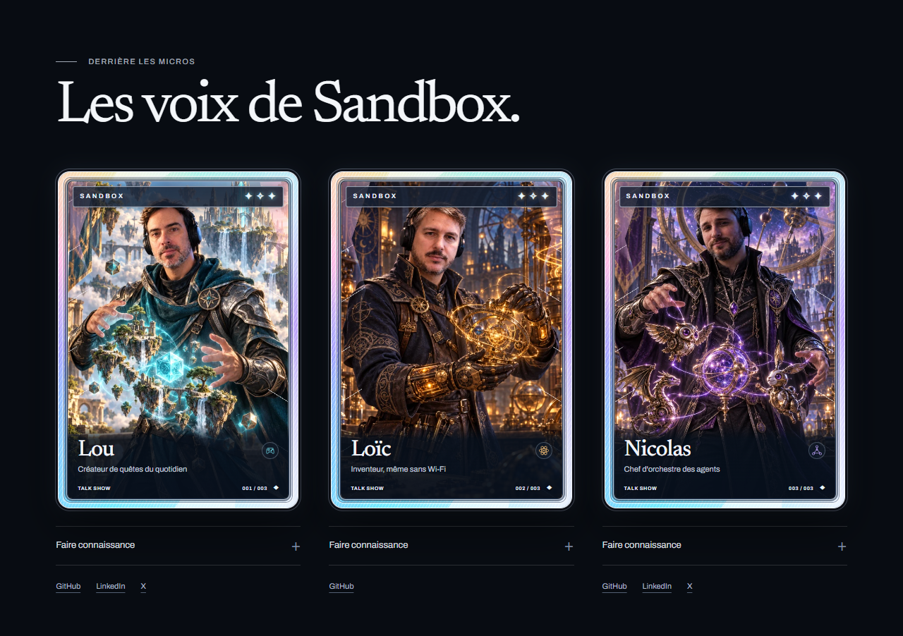

# Cartes holographiques : légende compacte

Date : 16 octobre 2026. Lou demande de regrouper cette retouche avec le prochain lot de corrections du site. La PR 69 est déjà fusionnée ; la PR 70 concerne la publication de BIS. Cette retouche reste donc locale en attente du prochain lot.

## Résultat

Le gros cartouche argenté est remplacé par une légende sombre fondue au bas de l'illustration. Le prénom passe à 30-32 pixels, le symbole à 24 pixels et l'espace réservé au titre est réduit. Les personnages deviennent plus visibles. Les visages, les illustrations, le cadre holographique, les biographies et les liens sociaux sont conservés.

## Fichiers à intégrer

- apps/site/src/components/home-host-card.module.css : habillage compact.
- apps/site/scripts/test-home-host-cards.mjs : contrôle de la hauteur réelle de la légende et de la taille des prénoms.
- docs/design-decisions/dd-0044-cartes-holographiques-des-animateurs.md : correction de conception et validation.
- Le présent compte rendu et ses deux captures.

Les autres modifications locales des conversations sur les écarts de production restent dans leur propre périmètre. Aucun commit ni push de cette retouche n'est effectué.

Lou demande ensuite explicitement d'intégrer cette retouche à la PR des écarts de production. Le code, le contrôle navigateur, la décision et les deux captures font désormais partie du lot `codex/parite-production-cartes`. Voir le [rapport de validation regroupé](ecarts-production-2026-10-16.md#lot-regroupé-pour-la-pr).

## Validation

Les quatre tailles 320, 390, 768 et 1440 pixels passent dans Edge avec Playwright : légende occupant au plus 22 % de la carte, prénom lisible, biographies et liens accessibles, inclinaison limitée, mouvements réduits respectés et absence de débordement.

Le contrôle global réussit : formatage, lint, types, 660 tests du site, 11 tests médias et 21 tests BIS.

La recette du lot regroupé retrouve un dépassement de 0,064 point du seuil de 22 % à 320 pixels dans le navigateur intégré. L'espacement supérieur de la légende est réduit de deux pixels sous 370 pixels pour respecter le même critère sur ce rendu.

[Rendu mobile](refonte-2026-10-16/captures/cartes-compactes-mobile.png).
