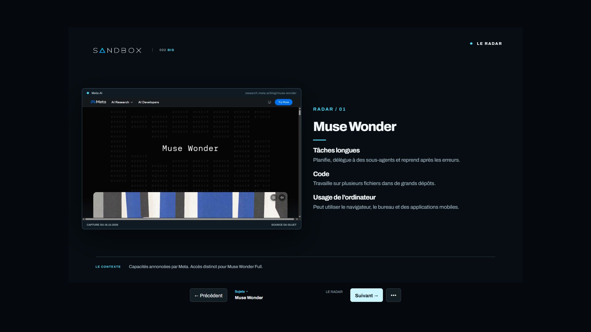
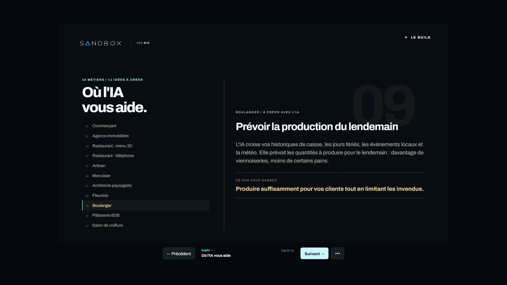

# Livraison groupée des conversations du 16 octobre 2026

Lou demande une seule PR avec les changements récents des différentes conversations. La PR #72 est complétée et synchronisée avec `main` au commit `5787f7f`. La refonte, les illustrations photoréalistes, les cartes compactes et le correctif des grands écrans sont déjà présents dans `main` après les PR #71 et #73.

## Contenu du lot

- Traductions : 2 403 textes sources couverts en anglais, espagnol et allemand. Indexation ES/DE selon les restrictions de la page française, canoniques et liens de langue réciproques, sitemap cohérent.
- Classements Models : priorité aux références fournisseurs existantes, séparation des homonymes, conservation des exclusions et des mesures historiques.
- Mesure : événements des liens du plateau, Speed Insights soumis au consentement, retrait des paramètres d'URL, exclusion de l'administration. Email de contact visible dans le footer.
- Épisode 002 BIS : une slide par actualité du Radar, onze usages pour dix métiers, retrait du Garage et textes demandés par Lou. La navigation directe des cas 10 et 11 fonctionne aussi avec le serveur de synchronisation local. Les 25 fichiers de la copie publique correspondent au prototype.
- OBS : fond de plateau sans personnages en PNG 1920 x 1080, génération native conservée et prompt documenté dans `brand/obs/`.

Le regroupement conserve les changements récents du dossier partagé et de la PR #72. Les conflits du composant d'accueil et des dictionnaires ont été résolus en conservant la refonte publiée et les nouveaux attributs de mesure. Les travaux locaux des autres conversations restent à leur emplacement.

## Vérifications

La validation du lot intégré réussit : format, lint, types, 686 tests du site, 7 tests du générique, 4 tests des jingles et 24 tests BIS, soit 721 tests. La compilation de production génère les 203 pages attendues. Les 34 contrôles HTTP des routes publiques, les 13 contrôles de polices OpenGraph, les contrôles HTTP de sécurité de l'administration et l'audit des dépendances réussissent. Les 325 URL du sitemap sont valides.

La revue indépendante a détecté un défaut de routage Speed Insights après retrait puis réacceptation du consentement. Le test reproduit le défaut sur l'ancien code. Le composant conserve désormais sa référence de routage après un premier accord et filtre chaque envoi selon le consentement courant. La régression vérifie une navigation cliente vers `/about`, sans rechargement du document ni second script, avec la bonne route dans le vital envoyé.

Les recettes navigateur du consentement passent : 9 contrôles lorsque GA4 est bloqué et 18 lorsqu'il est activé. Elles couvrent aussi le retrait, l'expiration, les onglets multiples et l'arrivée dans l'administration avec un accord déjà enregistré.

La recette visuelle BIS en 1920 x 1080 confirme le passage Muse vers Gemini puis le retour, la sélection des cas 10 et 11, l'absence de débordement horizontal et l'absence d'erreur JavaScript.

## Limites

Les essais utilisent des bases locales éphémères et des services de mesure simulés. Ils ne prouvent ni la réception des nouveaux événements dans GA4, ni une amélioration de performance en conditions réelles. Le suivi de l'issue #68 conserve les vérifications après déploiement, les historiques et profils de classement, ainsi que les deux rafraîchissements programmés consécutifs réussis.

Le support BIS public synchronise les onglets du même navigateur. La synchronisation avec une source OBS séparée reste celle du serveur local. Aucune mesure CPU ou FPS dans OBS n'est annoncée.

Le lot ne contient aucune migration supplémentaire, suppression de données ni modification de secret. La PR est soumise à revue, sans fusion dans cette tâche.
