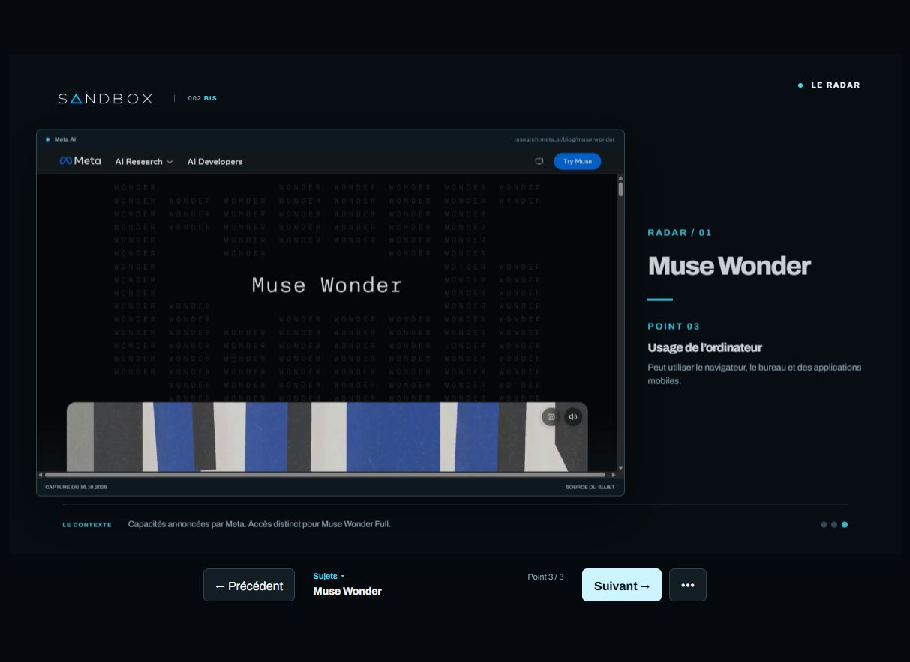
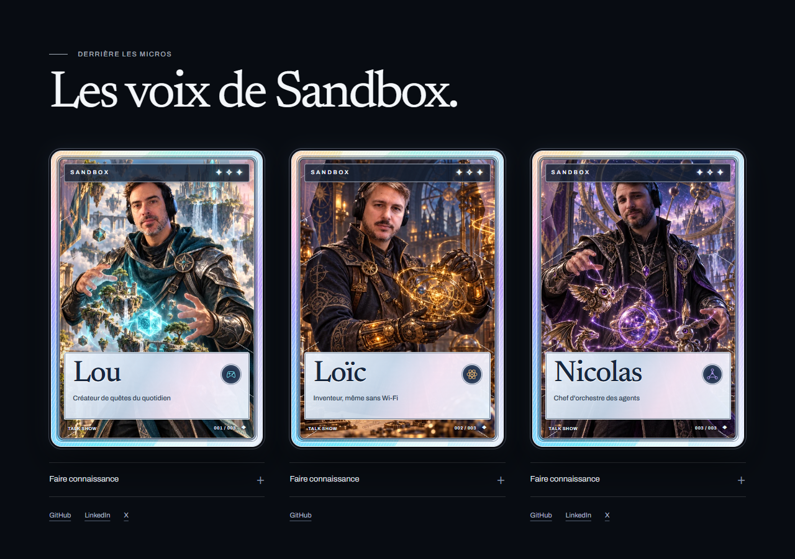
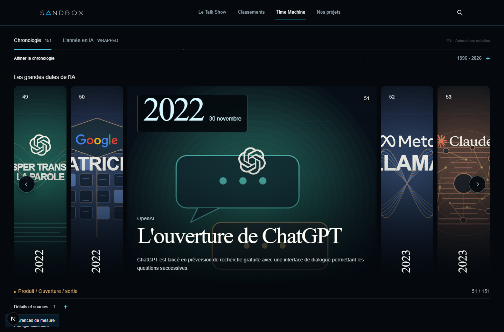

# Livraison globale Sandbox, PR 69

Date : 16 octobre 2026. Lou demande de regrouper le travail local absent de main dans une seule PR, avec vérification complète. La PR 69 est encore ouverte : elle est complétée avec les derniers changements, plutôt que doublonnée.

## Périmètre livré

Le lot reprend les quatre commits déjà présents dans la PR 69 et l'ensemble des sources, tests, illustrations et documents non suivis du checkout courant. La référence origin/main a été actualisée avant comparaison. Les retouches de l'autre conversation sur Épisode 002 BIS sont terminées avant de figer le lot.

- Accueil desktop avec plateau photoréaliste, porte animée, télévision et DeLorean cliquables ; version mobile éditoriale et entrée du vidéoclub.
- Cartes fantastiques holographiques des trois animateurs, titres bienveillants, biographies et liens sociaux. Les photos originales restent conservées.
- Carrousel Spotlight pour Okodukai, Song Maker et Sillage, couverture Sillage fournie par Lou, nouveaux visuels et réduction des marges cumulées.
- Désignation Talk Show, boutons YouTube et Spotify dans le footer, dernier replay et compatibilité des liens historiques.
- Time Machine avec 151 affiches distinctes, onze logos officiels, cartes dépliantes, dates proéminentes, flèches intégrées et navigation au clavier. Les étoiles s'arrêtent au repos et avec les mouvements réduits ; textes et sources restent accessibles sans JavaScript.
- Vidéoclub local, VHS photographiques, recherche, liste et fiches ; accès 404 en production conservé.
- Épisode 002 BIS : prototype indépendant, vue simplifiée, navigation entre chaque affichage et sujet, menu Sujets, options et captures des sources. Le support original reste intact. Ses 21 tests sont désormais intégrés au contrôle commun et à la CI.
- Corrections de l'issue 68 déjà présentes dans la PR : protections admin, cohérence des identités Models, journal YouTube durable, consentement et traductions.

Les anciennes copies de travail ont été inventoriées en lecture seule. Les modifications de fins de ligne seules ne sont pas reportées ; les anciennes propositions déjà reprises et les versions dépassées ne remplacent pas les fichiers actuels. Les sources du lot courant restent la référence.

## Vérifications

| Contrôle                     | Résultat                                                                                                     |
| ---------------------------- | ------------------------------------------------------------------------------------------------------------ |
| pnpm check                   | Formatage, lint, types, 656 tests du site, 11 tests médias et 21 tests BIS réussis                           |
| Build Next Webpack           | Réussi, 203 pages générées                                                                                   |
| Routes publiques             | 84 URL de sitemap et 29 parcours HTTP réussis                                                                |
| Administration de production | Protections HTTP réussies, sans base distante                                                                |
| Consentement                 | 22 contrôles navigateur réussis avec services externes simulés                                               |
| Time Machine                 | 37 contrôles réussis, dont dates/logos, clavier, filtres, exports et sources sans JavaScript                 |
| Accueil et responsive        | 48 combinaisons de pages et tailles vérifiées ; cartes et carrousel contrôlés à 320, 390, 768 et 1440 pixels |
| Dépendances                  | Audit pnpm sans vulnérabilité connue                                                                         |

Le scan Gitleaks des commits précédents et du lot préparé ne détecte aucun secret. Aucun fichier .env ni dossier de données locales n'entre dans le commit.

Le contrôle des cartes sur tablette survole une zone libre de la lamelle : les flèches superposées au milieu du carrousel gardent leur propre zone de clic. Les assertions de navigation, de focus et de placement restent actives.

La numérotation des décisions est réconciliée : DD-0045 concerne Épisode 002 BIS et DD-0046 les espacements publics. Aucun test ni contrôle de sécurité n'est désactivé.

## Conditions de mise en service

La création ou la mise à jour de la PR n'autorise ni fusion ni migration distante. Avant déploiement, sauvegarder les cibles et préparer les migrations 0012 à 0015 ; le limiteur admin répond 503 sans sa table. Les migrations historiques restent intactes. L'issue 68 reste ouverte pour les opérations et validations distantes.

Le prototype BIS et le vidéoclub ne sont pas ajoutés aux routes publiques de production. Aucun secret, fichier .env, base temporaire, journal, cache ou donnée éditoriale privée n'est publié. L'archive old/ reste intacte. Les résultats locaux ne valent pas mesure Lighthouse, mesure dans OBS, réception réelle de statistiques ou synchronisation vidéo à l'image près.

## Captures du lot

[Time Machine mobile](refonte-2026-10-16/captures/time-machine-mobile.png), [transition de l'accueil desktop](refonte-2026-10-16/captures/accueil-transition-desktop.png) et [transition de l'accueil mobile](refonte-2026-10-16/captures/accueil-transition-mobile.png).
