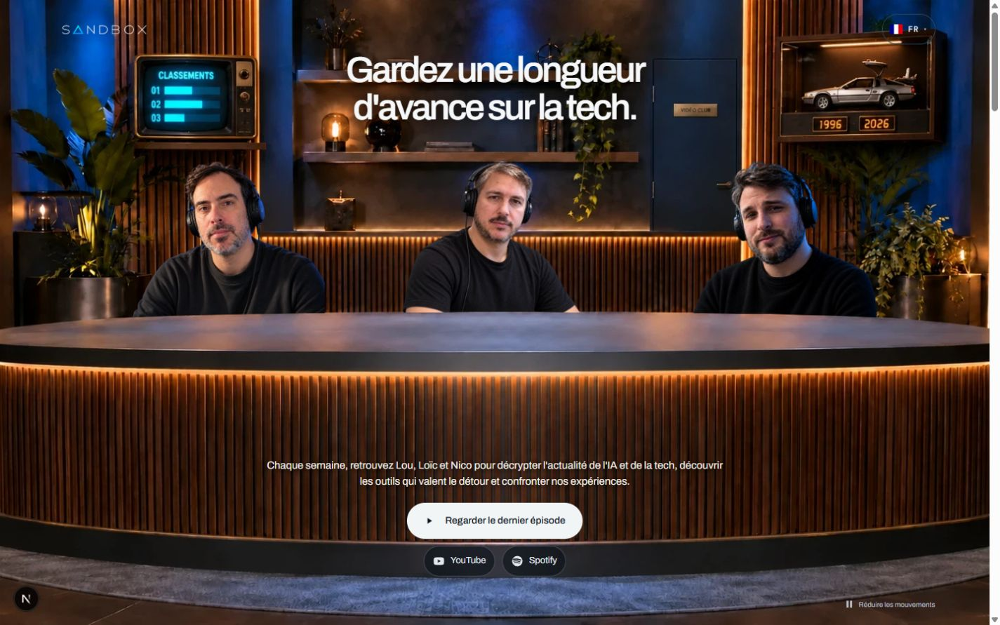
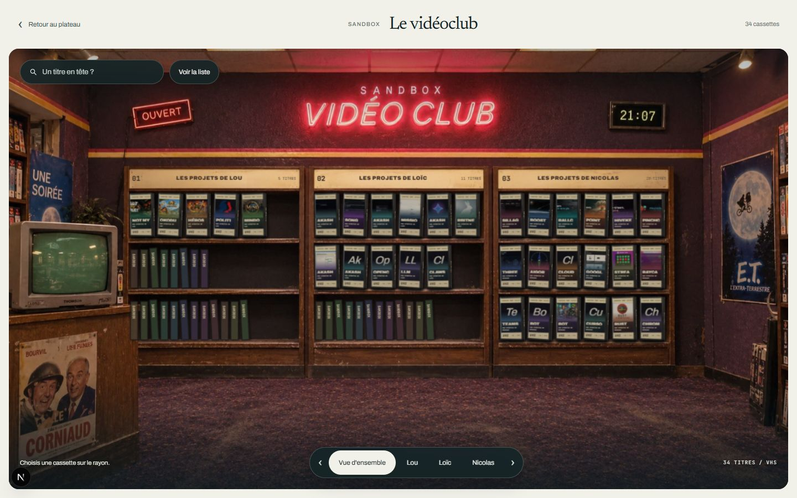

# Livraison groupée du 16 octobre 2026

Lou autorise une seule PR regroupant le travail local, après la fin de la conversation sur l'issue 68. Cette conversation est terminée avant la préparation du commit. La création de la PR n'autorise ni fusion ni migration distante.

## Périmètre

- Refonte de l'accueil : plateau desktop, vrais portraits, biographies équilibrées, version mobile éditoriale, liens des chaînes et accès au dernier épisode.
- Objets cliquables intégrés au décor : télévision vers les classements, DeLorean vers la Time Machine et porte animée vers le vidéoclub local. [Décision et provenance](../design-decisions/dd-0041-objets-du-plateau-vers-classements-et-time-machine.md).
- Vidéoclub photoréaliste, VHS interactives, recherche, liste, fiches et vidéos au clic. Le prototype conserve sa réponse 404 en production.
- Podcast regroupé sur `/podcast`, redirections des anciens parcours, liens et ressources de l'épisode pilote, catalogue et méthodes des classements.
- Mise à jour de la chronologie IA et de ses sources, consentement de mesure, confidentialité et parcours multilingues.
- Corrections de l'issue 68 : limiteur Postgres des connexions admin, CSP à nonce, prévention des nouvelles identités Models en double, journal YouTube durable, traductions complétées et documentation de mise en service. [Rapport et limites](issue-68-2026-10-16.md).

L'archive `old/`, les migrations SQL historiques, les secrets, les données éditoriales locales et les bases temporaires ne font pas partie des modifications publiées. Les médias sources précédents sont conservés.

## Dernier contrôle du lot commun

| Contrôle                                  | Résultat                                                                           |
| ----------------------------------------- | ---------------------------------------------------------------------------------- |
| `pnpm check`                              | Formatage, lint et types réussis ; 641 tests du site et 11 tests média réussis     |
| Build Next avec Webpack                   | Réussi, 203 pages générées                                                         |
| HTTP admin de production                  | Réussi, contrôles sans accès à une base distante                                   |
| Routes publiques                          | 84 URL du sitemap et 29 parcours HTTP réussis                                      |
| Consentement Playwright                   | 22 contrôles réussis sur Edge, services de mesure simulés                          |
| Audit pnpm                                | Aucune vulnérabilité connue signalée                                               |
| Gitleaks 8.30.1 sur le lot préparé        | Aucun secret détecté, résultats expurgés                                           |
| Tests YouTube de la conversation issue 68 | 57 réussis, dont trois intégrations sur Postgres local jetable                     |
| Easter eggs dans le navigateur            | Télé et DeLorean au clic et au clavier, animation de porte, destinations vérifiées |
| Responsive                                | Contrôles à 320, 390, 844 paysage, 1024 et 1440 pixels sur les parcours concernés  |

L'ancien échec de couverture des traductions anglaises est résolu dans le lot commun. La vérification du build utilise `next build --webpack` ; le blocage local Turbopack est décrit dans le rapport de l'issue 68. Aucun gain Lighthouse ni réception réelle de statistiques n'est déduit des tests locaux.

## Avant mise en production

La nouvelle migration `0015` doit être appliquée avant de déployer le limiteur admin : sans compteur disponible, les connexions répondent 503. La production attend aussi les migrations `0012` à `0014`, la sauvegarde et la vérification des cibles Preview/Production. Aucun de ces changements distants n'est exécuté par cette livraison.

Les secrets du planificateur, la calibration des classements, les validations GA4, OAuth YouTube, l'écoute des Shorts et la relecture native restent suivis dans l'issue 68. Le journal YouTube n'active pas automatiquement les écritures. L'issue reste ouverte.

## Captures

[Accueil mobile et nouvelle porte](refonte-2026-10-15/captures/accueil-porte-mobile-v12.jpg).
