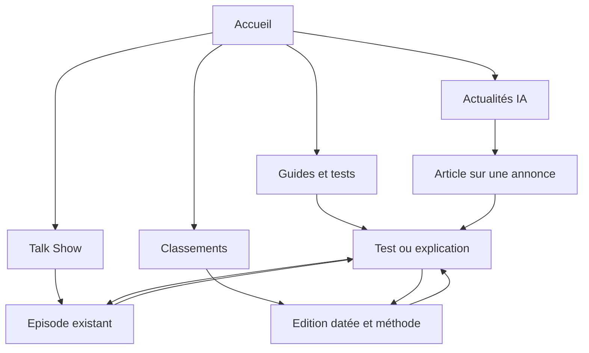

# Contenus à préparer pour développer la visibilité de Sandbox

Plan proposé le 18 octobre 2026, à partir de l'[audit](audit.md), de l'épisode public et des projets de l'équipe. Les formulations de recherche sont des hypothèses de travail. Les volumes, difficultés et positions restent inconnus tant que les données correspondantes ne sont pas accessibles.

## Ligne éditoriale proposée

Expliquer l'actualité IA à partir d'essais, de projets et de sources vérifiables. Commencer par les outils, les agents de code et l'IA locale/open source. Développer ensuite les thèmes qui trouvent des lecteurs et que l'équipe peut traiter avec une expérience directe.

Un article doit apporter un élément propre à Sandbox : essai, capture, protocole, difficulté rencontrée, réalisation ou analyse de données. Une reprise d'annonce doit expliquer ce qui change pour le lecteur et distinguer la promesse du fournisseur de ce que l'équipe a vérifié. [Critères Google sur le contenu utile](https://developers.google.com/search/docs/fundamentals/creating-helpful-content).

## Architecture proposée

Les chemins ci-dessous sont à créer seulement avec leurs premiers contenus réels. Les URL existantes, notamment `/episodes/1`, restent conservées. Ne pas ouvrir des dizaines de catégories vides.

| Destination proposée               | Fonction                                       | Liens à prévoir                                             |
| ---------------------------------- | ---------------------------------------------- | ----------------------------------------------------------- |
| `/actualites`                      | Fil des articles récents, sélection éditoriale | Articles et dossiers effectivement disponibles              |
| `/actualites/{slug}`               | Une annonce expliquée                          | Source primaire, guide utile et replay pertinent            |
| `/guides`                          | Guides, explications et essais maintenus       | Chaque contenu et ses thèmes                                |
| `/guides/{slug}`                   | Une question ou un essai documenté             | Articles récents, sources, replay et éventuel classement    |
| `/podcast` et `/episodes/{number}` | Émission et replays                            | Articles issus de l'épisode et projets cités                |
| `/charts` et routes actuelles      | Données et éditions                            | Méthode, dates, limites et analyses éditoriales pertinentes |

Les thèmes peuvent commencer comme une sélection de liens dans ces hubs. Une page thématique autonome vient quand elle possède plusieurs contenus utiles et une introduction propre. Les anciennes routes d'articles simulés ne doivent pas devenir indexables par simple changement de navigation.

Navigation proposée lors de l'ouverture éditoriale : Actualités IA, Guides et tests, Talk Show, Classements. Garder Nos projets et Time Machine accessibles depuis les zones existantes et les liens contextuels. Ce changement reste une proposition de conception, sans modification du site dans ce lot.

## Sujets prioritaires

| Priorité | Recherche ou besoin visé               | Sujet proposé                                                        | Format                | Apport propre et condition de publication                                                  |
| -------- | -------------------------------------- | -------------------------------------------------------------------- | --------------------- | ------------------------------------------------------------------------------------------ |
| P1       | Codex Claude Code OpenCode différences | Codex, Claude Code et OpenCode : comparer leurs approches            | Guide et comparaison  | Protocole commun, versions et limites ; exploiter le débat public sans inventer un gagnant |
| P1       | harnais agent IA définition            | Qu'est-ce qu'un harnais d'agent IA ?                                 | Explication           | Exemples concrets tirés de Sillage et de l'épisode                                         |
| P1       | mémoire contexte agent IA              | Mémoire et contexte : les limites rencontrées dans nos essais        | Décryptage            | Cas observés et versions ; aucune mesure de gain sans relevé                               |
| P1       | skills agent IA installer              | Installer un skill d'agent : exemple, vérification et limites        | Tutoriel              | Installation réellement exécutée et captures ; compatibilité nommée                        |
| P1       | skills Claude Code                     | Quels skills Claude Code avons-nous testés ?                         | Sélection testée      | Essai par skill, tâche, version et source ; distinguer sélection éditoriale et popularité  |
| P1       | skills Codex                           | Quels skills Codex avons-nous testés ?                               | Sélection testée      | Même exigence de preuve ; pas de duplication du contenu Claude Code                        |
| P1       | Sillage agents de code                 | Sillage : comment nous organisons un projet avec plusieurs agents    | Retour de réalisation | Démonstration reproductible et limites ; lien avec la fiche projet existante               |
| P1       | actualité IA semaine                   | Le Radar Sandbox : les annonces de la semaine expliquées             | Récapitulatif écrit   | Sources et dates ; retenir les sujets traités, avec commentaire propre                     |
| P2       | IA locale démarrer                     | Faire tourner une IA localement : notre configuration et ses limites | Guide pratique        | Matériel et versions réellement utilisés ; pas de recommandations matérielles sans essai   |
| P2       | Akasha OS fonctionnement               | Ce que nous avons construit avec Akasha OS                           | Retour de réalisation | Montrer un usage réel et les difficultés, lien vers le projet                              |
| P2       | projet open source IA progression      | Les projets IA qui progressent dans nos relevés                      | Analyse de données    | Collectes fraîches, fenêtre comparable et historique suffisant avant rédaction             |
| P2       | classement modèles IA comprendre       | Comment lire un classement de modèles IA ?                           | Guide de méthode      | Séparer tâches, sources, dates et scores ; donner des exemples sans inventer de benchmark  |
| P2       | popularité GitHub qualité              | Les étoiles GitHub suffisent-elles à choisir un outil ?              | Analyse               | Illustration par les données disponibles et un essai distinct                              |
| P2       | MCP skills différences                 | MCP, skills et prompts : à quoi sert chaque brique ?                 | Explication           | Exemples testés et sources officielles à vérifier au moment de rédiger                     |
| P2       | musique IA création test               | Créer un morceau avec Song Maker : notre méthode                     | Tutoriel et test      | Utiliser un projet dont les sources et droits sont confirmés, montrer le résultat          |
| P2       | agent code même tâche test             | La même tâche confiée à plusieurs agents : protocole et résultats    | Test reproductible    | Dépôt ou scénario figé, ressources et critères comparables ; essai à réaliser              |
| P3       | histoire intelligence artificielle     | Comprendre les étapes qui ont conduit aux agents actuels             | Dossier historique    | Réutiliser les sources de Time Machine et apporter une narration distincte                 |
| P3       | nouveau modèle IA annonce              | Ce que change la prochaine annonce de modèle suivie par l'équipe     | Actualité             | Sujet et version à choisir au moment de l'annonce ; source primaire et essai si possible   |
| P3       | workflow projet IA                     | De l'idée au projet : les étapes et les erreurs de notre build       | Retour d'expérience   | Choisir un projet réel avec traces et captures disponibles                                 |
| P3       | outils IA actualités bilan             | Ce qui a changé en un mois dans nos outils IA                        | Bilan                 | Relever les changements réels et conserver les liens vers les essais précédents            |

Ces titres sont des briefs. Aucun test, résultat, comparatif ou article n'est présenté comme déjà réalisé par ce plan. Les recherches générales `actualité IA`, `actualités intelligence artificielle` et `infos IA` servent le hub et la couverture éditoriale ; elles ne justifient pas trois pages presque identiques.

## Premières publications à préparer

Ordre de démarrage proposé : le guide sur les harnais, le comparatif d'approches issu de l'épisode, le décryptage mémoire/contexte, puis un premier tutoriel de skill vérifié. Ils exploitent un matériau existant. Les sujets qui exigent de nouveaux essais attendent leurs résultats.

La cadence de départ à éprouver est de deux contenus écrits par semaine, dont un guide ou test et un article d'actualité ou récapitulatif. Ce n'est pas un quota de pages : réduire le rythme si les preuves ou la relecture manquent. Le Talk Show conserve son rythme décidé. La capacité de rédaction disponible n'a pas été mesurée.

Pour chaque sujet, vérifier quelques résultats actuels et formuler l'apport propre avant la rédaction. Le comparatif Claude Code/Codex est déjà couvert par plusieurs sites : son intérêt repose sur votre protocole, pas sur une concurrence supposée faible.

## Contrat d'un article prêt à publier

- Une question clairement traitée et une réponse compréhensible dès l'introduction.
- Des sources primaires liées près des affirmations, avec les dates, versions et conditions utiles.
- Un auteur réel identifié. Les projets personnels ou intérêts de l'équipe sont signalés dans le contexte concerné.
- Les essais et observations distingués des annonces fournisseurs et de l'avis de l'auteur.
- Un title et une description uniques ; un H1 descriptif ; une URL stable ; une canonique propre.
- Des liens contextuels vers les contenus utiles, sans minimum artificiel de liens ou de mots.
- Une image représentative suffisamment grande, adaptée au mobile ; des alternatives textuelles quand elles sont utiles.
- Des dates de publication et de modification exactes ; aucune actualisation de date sans changement substantiel.
- Des données structurées conformes au texte visible, une entrée de sitemap et un contrôle HTTP.
- Une relecture humaine et l'autorisation de publication prévue par AGENTS.md.

## Distribution et mesure

Préparer avec chaque article un extrait adapté aux réseaux déjà utilisés et un lien dans la description de l'épisode concerné. Aucune publication externe n'est effectuée ici. Les collaborateurs et créateurs d'outils peuvent relayer un essai qui les concerne ; aucun message ne leur est envoyé dans ce lot.

Les liens gagnés doivent découler d'une ressource utile : test reproductible, jeu de données correctement expliqué, exemple réutilisable ou entretien original. Ne pas acheter de liens ni inventer de reconnaissance. L'achat d'un outil SEO n'est pas nécessaire pour commencer les inspections et analyser les premières requêtes.

À 28 jours de données disponibles, comparer les impressions hors marque par page et les requêtes associées. Améliorer les pages qui répondent déjà à une demande observée. Ne pas confondre un pic ponctuel de Discover, une citation par un assistant et une progression durable des clics de recherche.
