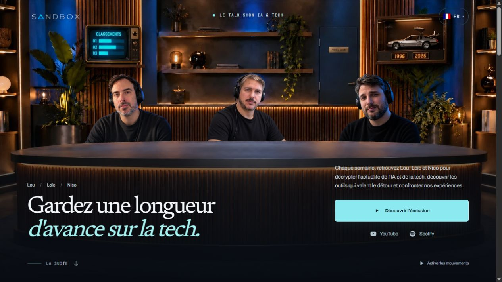
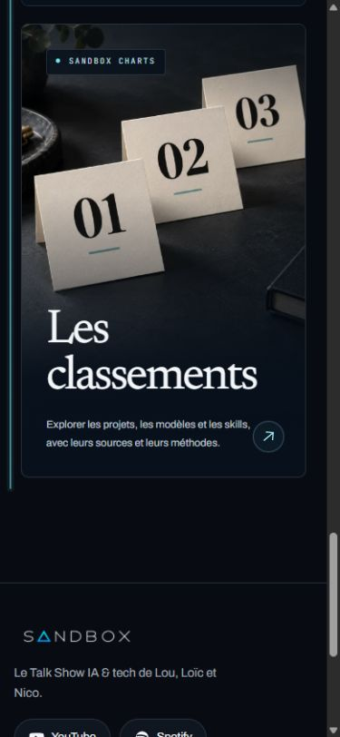

# Vérification de la refonte avant PR

16 octobre 2026. Lou autorise la vérification complète puis la création d'une seule PR pour la refonte de l'accueil.

## Périmètre

Branche `codex/landing-cinematique`, issue de `origin/main` au commit `db22491`. La copie isolée contient le plateau, les chapitres, les mouvements, le fil de progression, les cartes équipe et projets, les deux illustrations photoréalistes, les traductions nécessaires et leur documentation. Aucune dépendance n'est ajoutée.

Les modifications de collecte, d'indexation et de mesure font déjà l'objet de la PR 72. Elles ne sont pas reprises ici. La copie de travail initiale et ses autres changements sont conservés.

## Revue et correction

Les trois agents ont relu la direction artistique, les mouvements et l'ergonomie. Un conflit CSS pouvait maintenir le titre visible pendant le zoom d'entrée dans le vidéoclub. Les animations d'entrée ne conservent plus leur opacité après leur fin et sont retirées dès que la porte s'ouvre.

Le contrôle dans le navigateur montre `data-opening="true"`, une opacité du titre à `0` et aucune animation d'entrée active pendant le zoom. La navigation arrive ensuite sur le vidéoclub. Aucun autre problème bloquant n'a été démontré par ces revues.

## Contrôles de la branche isolée

- `pnpm install --offline --frozen-lockfile` : installation réussie à partir du cache, sans changement du verrou de dépendances.
- `pnpm check` : réussi après remise au format du fichier assemblé. Prettier, ESLint et TypeScript sont valides. Les 673 tests du site dans 106 fichiers passent, ainsi que 7 tests d'introduction, 4 tests de jingles et 22 tests du projet BIS, soit 706 tests.
- `pnpm --filter @podcast/site build` : réussi avec Turbopack, 203 pages statiques générées.
- `test:og:tracing` : les 13 routes OpenGraph incluent leurs cinq polices.
- `test:admin:http` : contrôles de sécurité HTTP réussis, sans accès à une base réelle.
- `test:public-routes` : 82 adresses du sitemap valides sur 82 et 34 contrôles de parcours réussis.
- `pnpm audit --audit-level=high` : aucune vulnérabilité connue signalée.

Le build de cette branche est servi temporairement sur `http://127.0.0.1:3221/`. Le catalogue d'épisodes est vide dans cet environnement isolé : l'accueil propose correctement "Découvrir l'émission" et ne fabrique aucun replay. Les contenus de production ne sont pas modifiés.

Recette dans le navigateur Codex sur ce build :

- Huit largeurs : 320, 390, 700, 701, 900, 901, 1 280 et 1 920 pixels. Aucun débordement horizontal, plateau sans position sticky, titre dégagé des portraits et action contenue dans le plateau.
- Accès Time Machine du décor : les points visibles contrôlés à 901, 1 280 et 1 920 pixels restent cliquables, avec priorité conservée au sélecteur de langue. Le contrôle est fait après retour en haut de page pour neutraliser la restauration du défilement lors d'un redimensionnement.
- Pause globale : les neuf révélations de cet accueil sans épisode sont visibles, sans transformation ni animation.
- Biographie de Lou : ouverture et fermeture vérifiées. Le fil reste présent après le changement de hauteur.
- Projets : le bouton suivant sélectionne Song Maker ; la touche End sélectionne Sillage et conserve le focus sur le lien actif.
- Panneaux Explorer : les deux images sont chargées ; leurs liens ouvrent respectivement Sandbox Charts et Time Machine en haut de page.
- Console du navigateur : aucune erreur relevée pendant cette passe.

Le nombre de tests diffère des premières recettes parce que cette branche exclut les changements en cours de la PR 72.

## Captures du build

Les captures ci-dessous proviennent du navigateur, avec les deux dernières illustrations intégrées.

## Limites

Les captures et les essais en navigateur utilisent des dimensions de téléphone dans Chromium. Ils ne remplacent pas un essai tactile sur un appareil physique ni un audit avec lecteur d'écran. La commande de pause est vérifiée ; la préférence système de réduction des mouvements est relue dans les styles et le code, sans modification du réglage du système.

Les scripts du dépôt utilisant Playwright ne sont pas lancés localement pendant cette recette. Les interactions sont réalisées avec le navigateur Codex. Les tests HTTP utilisent des données jetables en local et ne modifient aucune base réelle. Aucune mesure de FPS ou de performance de production n'est revendiquée.
